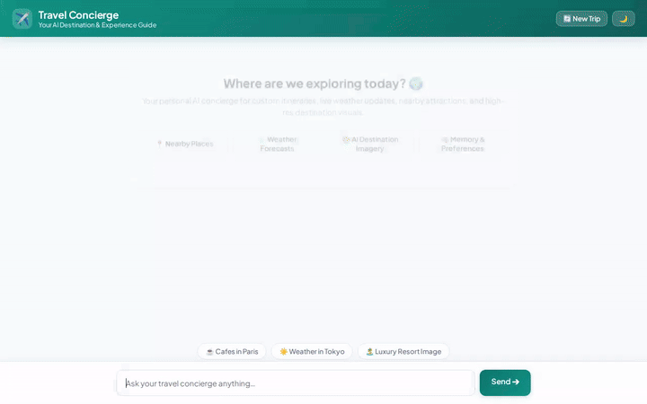

# Travel Concierge AI Agent

An intelligent, multi-modal travel concierge agent built on the **Google Agent Development Kit (ADK)** and powered by **Gemini 2.5 Flash**. The agent features persistent user memory, real-time Firestore catalog search, image & video generation, Google Maps integration, live weather and currency tools, python code execution, and an adaptive Agentic UI (A2UI) custom frontend.



---

## 🚀 Key Features & Capabilities

Based strictly on the codebase implementation in `app/`:

- **🧠 Persistent User Memory (Vertex AI Memory Bank)**: Remembers user travel preferences, dietary restrictions, allergies, and health requirements across sessions using `VertexAiMemoryBankService` and `PreloadMemoryTool`.
- **🗄️ Firestore Destination Catalog**: Queries, inspects, and expands destination collections in Cloud Firestore via `search_destinations`, `get_destination_details`, and `add_destination`.
- **🖼️ AI Image Generation (Imagen 3)**: Generates high-quality destination photos using `generate_destination_image`, uploading assets directly to Google Cloud Storage (GCS) and registering them in the agent artifacts panel.
- **🎥 AI Video Generation (Gemini Omni)**: Generates 3-second travel preview videos using `gemini-omni-flash-preview` in the `global` region via `generate_destination_video`, storing bytes directly in GCS.
- **📍 Google Maps Integration**: Resolves physical location coordinates via `geocode_address` and discovers nearby points of interest with `find_nearby_places`.
- **☀️ Weather & Currency Services**: Fetches live weather conditions via `get_live_weather` and computes real-time exchange rates via `convert_currency`.
- **🐍 Python Code Sandbox**: Performs complex travel math, budget calculations, and itinerary optimization using `AgentEngineSandboxCodeExecutor`.
- **🎨 Agentic User Interface (A2UI)**: Renders structured, responsive rich cards, image viewports, and text layouts via `A2uiSchemaManager`.
- **🌙 Modern Web Frontend**: A custom web interface with dark mode toggles, image lightbox modals, quick prompt chips, and session reset.

---

## 🛠️ Integrated Google Cloud Services

- **Vertex AI Agent Engine (ADK Runtime)**: Orchestrates agent logic and execution.
- **Gemini 2.5 Flash**: Core LLM for multi-turn reasoning and tool orchestration.
- **Vertex AI Memory Bank**: Managed long-term memory store for user facts.
- **Google Cloud Firestore**: Scalable NoSQL database for destination records.
- **Google Cloud Storage (GCS)**: Asset storage bucket for AI-generated images and videos.
- **Vertex AI Imagen 3 (`imagen-3.0-generate-002`)**: Text-to-image generation.
- **Vertex AI Omni Model (`gemini-omni-flash-preview`)**: Multimodal video preview generation.
- **Google Maps Platform (Geocoding & Places APIs)**: Geospatial lookups and points of interest.
- **Google Cloud Run**: Containerized deployment target for the web frontend.

---

## 📋 Planned / Future Improvements

- **Interactive Itinerary Builder**: Multi-day trip drag-and-drop calendar planner (*planned, not yet implemented*).
- **Direct Flight & Hotel Booking**: Integration with live booking GDS APIs (*planned, not yet implemented*).

---

## 💻 Local Setup & Development Instructions

### Prerequisites

- Python 3.11+
- Node.js 18+ (for frontend development & demo recording)
- Google Cloud SDK (`gcloud`) authenticated to your GCP project with required APIs enabled.

### 1. Environment Configuration

Create a `.env` file in the project root:

```bash
PROJECT_ID="your-gcp-project-id"
LOCATION="us-east1"
FIRESTORE_PROJECT_ID="your-gcp-project-id"
MAPS_API_KEY="<YOUR_MAPS_API_KEY>"
```

### 2. Install Python Dependencies

```bash
python3 -m venv .venv
source .venv/bin/activate
pip install -r requirements.txt
```

### 3. Run the Frontend Locally

Navigate to the `frontend/` directory, configure environment variables, and start the local server:

```bash
export AGENT_ENGINE_RESOURCE_NAME="projects/<PROJECT_ID>/locations/<REGION>/reasoningEngines/<RESOURCE_ID>"
export AGENT_DIRECTORY="app"
export PORT=8080

python main.py
```

Open your browser to port `8080` on `localhost` to interact with the custom frontend.

---

## 🎬 Recording Demo Videos

To re-record a demo video of the agent driving the UI with Playwright and Lyria background music:

```bash
# Ensure dependencies are installed locally
npm install playwright
npx playwright install chromium

# Run the demo recorder
NODE_PATH=./node_modules node .agents/skills/record-demo/record-agent.js \
  -u http://localhost:8080/ \
  -q "Search for Culture & History destinations in our catalog" \
  -q "Generate a luxury photo of the Golden Pavilion temple in Kyoto" \
  --wait 30000 \
  --speed 1.5 \
  --music "upbeat lo-fi chill background beats" \
  -o travel_concierge_lofi_demo.webm
```

To convert `.webm` recordings to a looping `.gif`:

```bash
ffmpeg -y -i travel_concierge_demo.webm -vf "fps=10,scale=720:-1:flags=lanczos,split[s0][s1];[s0]palettegen[p];[s1][p]paletteuse" -loop 0 demo.gif
```
